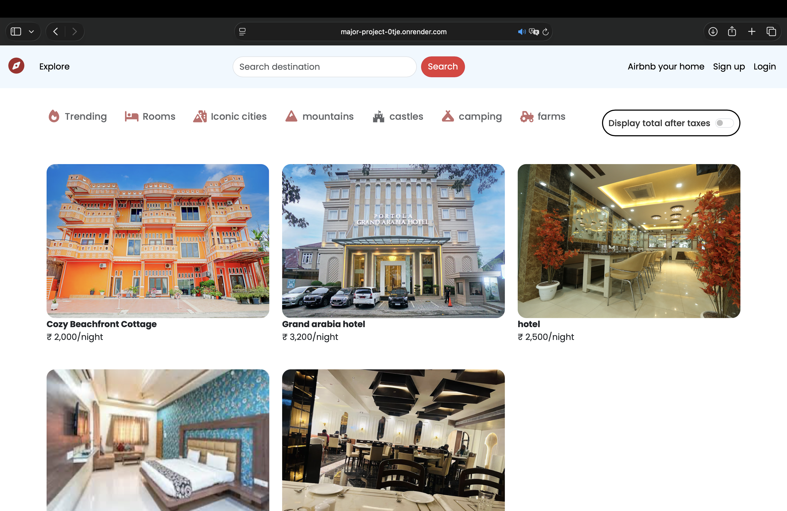
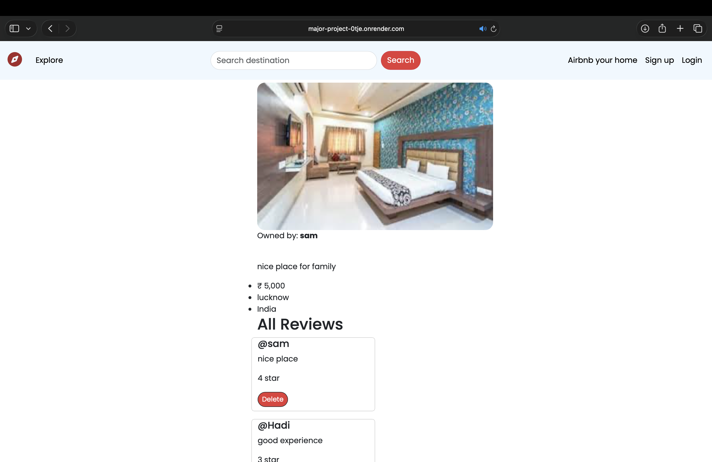
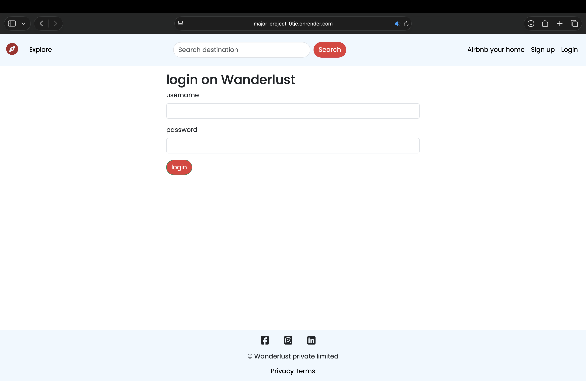

# Wanderlust — Travel & Stay Booking Platform

# Overview

Wanderlust is a full-stack travel and stay booking web application inspired by platforms like Airbnb. Users can explore different places, create property listings, upload images, write reviews, and manage their bookings through a simple and responsive interface.

I built this project to improve my practical knowledge of full-stack web development and understand how real-world web applications work from frontend to backend.

---

# Features

* 🔐 User Authentication & Authorization
* 🏡 Create, Edit, and Delete Listings
* 📸 Image Upload Functionality
* ⭐ Reviews and Ratings
* 📍 Location-Based Listings
* 🔎 Search and Filter Options
* 📱 Responsive Design for Mobile & Desktop
* ☁️ Cloud Image Storage
* 🛡 Secure Backend Routes and Validation

---

# 🛠 Tech Stack

## Frontend

* HTML
* CSS
* JavaScript
* Bootstrap
* EJS

## Backend

* Node.js
* Express.js

## Database

* MongoDB
* Mongoose

## Authentication & Tools

* Passport.js
* Express Session
* Cloudinary
* Git & GitHub
* Postman

---

# 🧠 What I Learned

While building Wanderlust, I learned:

* How to build REST APIs
* Authentication and authorization flow
* MVC architecture
* Database relationships using MongoDB
* Middleware handling in Express
* Image upload and cloud storage
* Error handling and debugging
* Deployment basics and environment variables
* Writing cleaner and modular backend code

---

# 💡 Challenges Faced

One of the biggest challenges was managing authentication and protected routes properly. I also faced issues while handling image uploads and database relationships.

I solved these problems by reading documentation, debugging step by step, and improving the structure of the project using reusable middleware and modular code.

---

# 📈 Future Improvements

Some features I plan to add in the future:

* 💳 Online payment integration
* 🗺 Interactive maps
* 📅 Real-time booking system
* 🤖 AI-based travel recommendations
* 📊 Admin dashboard
* 🌐 Multi-language support

---

# 📸 Screenshots

## Home Page


## Listing Page


## Login Page


# ⚙️ Installation & Setup

```bash
# Clone repository
git clone <your-github-link>

# Move to project folder
cd wanderlust

# Install dependencies
npm install

# Start server
npm start
```

---

# 📂 Project Structure

```bash
wanderlust/
│
├── models/
├── routes/
├── controllers/
├── views/
├── public/
├── middleware/
├── utils/
├── app.js
└── package.json
```

---

# 🎯 Why This Project Matters

This project helped me understand how full-stack applications are built and managed in real-world development. It improved my backend development skills, problem-solving ability, and understanding of authentication, database handling, and responsive UI design.

---

# 🔗 Links

- Live Demo: [Wanderlust Live](https://major-project-0tje.onrender.com)

- GitHub Repository: [GitHub Repo](https://github.com/PrathamSingh777/Major-Project)
---

# 👨‍💻 Author

Pratham Shakya

Aspiring Software Engineer | Full-Stack Developer

LinkedIn: [linkedIn](https://www.linkedin.com/in/pratham-singh-3313902aa)
GitHub:  [GitHubprofile](https://github.com/PrathamSingh777)
